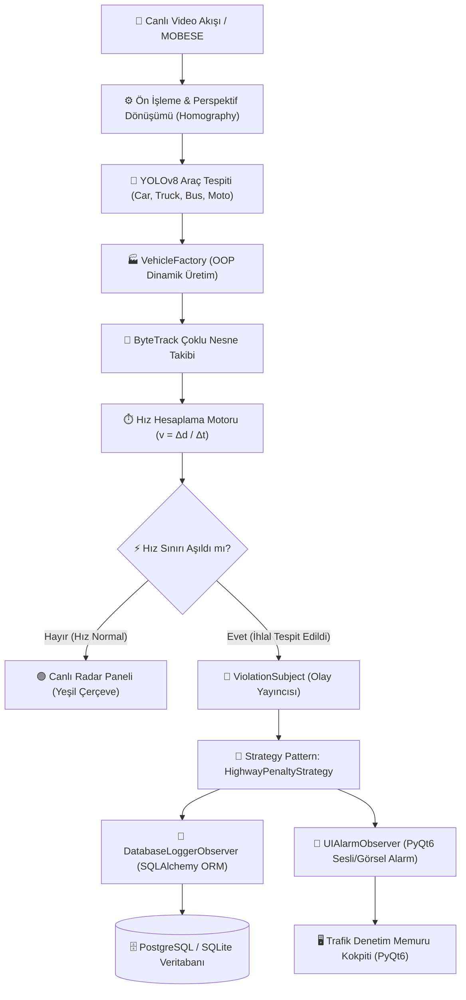

# CezAI 🚗⚡📸
> **Yapay Zeka Destekli Otoyol Hız Takip ve Dinamik Ceza Yönetim Sistemi**  
> *AI-Driven Highway Vehicle Speed Tracking and Dynamic Penalty Enforcement System*

[](https://www.python.org/)
[](https://opencv.org/)
[](https://github.com/ultralytics/ultralytics)
[](https://www.sqlalchemy.org/)
[](https://riverbankcomputing.com/software/pyqt/)
[](#yazılım-mimarisi-ve-tasarım-kalıpları)

---

## 📌 Proje Hakkında (About the Project)

**CezAI**, otoyollarda akan araç trafiğini yüksek çözünürlüklü kamera akışları üzerinden gerçek zamanlı bilgisayarlı görü ve derin öğrenme modelleriyle takip eden, araçların anlık hızlarını piksel-metre perspektif kalibrasyonuyla (**Homography**) milisaniye hassasiyetinde tespit eden akıllı bir trafik denetleme ve yönetim sistemidir.

Yasal hız limitini aşan araçlar tespit edildiğinde; araç sınıfına (otomobil, kamyon, otobüs, motosiklet) özgü yasal limitler dinamik olarak devreye girer. **2918 sayılı Karayolları Trafik Kanunu** baremlerine göre kademeli para ve ceza puanı hesaplanır, görsel kanıtlar (video karesi ve ihlal fotoğrafı) ile birlikte ilişkisel veritabanına loglanır.

### 👥 Proje Ekibi (Gazi CENG - BM201 İleri Programlama)
- **Sinan Gün** — `25118080047`
- **Hasan Can Bayındır** — `23118080091`
- **İsmail Can Anlaş** — `24118080098`
- **Ahmet Kıymık** — `24118080704`

---

## 🏗️ Sistem Mimarisi (Architecture)



---

## 🧩 Nesne Yönelimli Programlama & Tasarım Kalıpları (OOP & Patterns)

Proje, **BM201 İleri Programlama** standartlarına uygun kurumsal nesne yönelimli mimariyle yapılandırılmıştır:

1. **Encapsulation (Kapsülleme):**  
   Hız, plaka, ihlal zamanı ve ceza tutarı gibi kritik nitelikler private/protected (`_speed`, `_plate`) tutulur. Erişim `@property` ve iş kurallı setter mekanizmalarıyla doğrulanır; negatif veya mantıksız hız değerleri özel exception fırlatır.

2. **Inheritance & Polymorphism (Kalıtım ve Çok Biçimlilik):**  
   - `Vehicle` soyut sınıfından (`Car`, `Truck`, `Bus`, `Motorcycle`) türetilir.
   - Her araç sınıfı `get_speed_limit()` ve `calculate_excess_ratio()` metotlarını kendi yasal hız kurallarına göre override eder (örn. Otomobil için 140 km/s, Kamyon için 90 km/s).
   - Kullanıcı hiyerarşisinde `User` soyut sınıfından `Admin` ve `Operator` türetilir.

3. **Strategy Pattern (Strateji Kalıbı):**  
   Ceza hesaplama mantığı `IPenaltyStrategy` arayüzü ile soyutlanmıştır. Yasal düzenleme baremlerine göre:
   - **1. Kademe (%10 - %30 Aşım):** 1.506 TL para cezası, 10 ceza puanı
   - **2. Kademe (%30 - %50 Aşım):** 3.135 TL para cezası, 15 ceza puanı
   - **3. Kademe (%50 ve Üzeri Aşım):** 6.439 TL para cezası, 20 ceza puanı

4. **Observer Pattern (Gözlemci Kalıbı):**  
   Hız ihlali oluştuğunda `ViolationSubject`, kayıtlı tüm gözlemcileri (`DatabaseLoggerObserver`, `UIAlarmObserver`) asenkron olarak tetikler. Gevşek bağlılık (loose coupling) sağlanır.

5. **Factory Pattern (Fabrika Kalıbı):**  
   YOLO modelinden gelen etiketlere (`car`, `truck`, `bus`, `motorcycle`) göre uygun nesnelerin çalışma zamanında oluşturulmasını `VehicleFactory` yönetir.

6. **Repository Pattern (Depo Kalıbı):**  
   Veritabanı CRUD operasyonları `IViolationRepository` arayüzü ve `SqlAlchemyViolationRepository` somut sınıfı ile iş mantığından tamamen soyutlanmıştır.

---

## 📂 Dizin Yapısı (Project Structure)

```text
CezAI/
├── docs/                         # Resmi Proje Proposal ve RoadMap belgeleri
│   ├── BM201_CezAI_Project_Proposal.docx
│   ├── BM201_CezAI_Project_Proposal.pdf
│   ├── BM201_CezAI_Project_RoadMap.docx
│   └── BM201_CezAI_Project_RoadMap.pdf
├── src/
│   ├── core/                     # Çekirdek arayüzler, istisnalar ve gözlemciler
│   │   ├── exceptions.py
│   │   ├── interfaces.py
│   │   └── observers.py
│   ├── models/                   # Araç ve ihlal veri modelleri (OOP)
│   │   ├── vehicle.py
│   │   ├── violation.py
│   │   └── user.py
│   ├── vision/                   # Bilgisayarlı görü, homografi ve nesne tespiti
│   │   ├── calibration.py
│   │   ├── detector.py
│   │   └── tracker.py
│   ├── rules/                    # Ceza hesaplama kuralları (Strategy Pattern)
│   │   └── penalty_engine.py
│   ├── database/                 # SQLAlchemy ORM ve Repository katmanı
│   │   ├── connection.py
│   │   ├── models.py
│   │   └── repository.py
│   └── gui/                      # PyQt6 Masaüstü Yönetim Kokpiti
│       ├── main_window.py
│       └── views/
│           ├── live_radar.py
│           └── violations_view.py
├── tests/                        # Pytest birim ve entegrasyon testleri
│   ├── test_vehicles.py
│   ├── test_penalty_strategy.py
│   └── test_observer.py
├── requirements.txt
├── .gitignore
└── README.md
```

---

## 🚀 Kurulum ve Çalıştırma (Quickstart)

### 1. Depoyu Klonlayın
```bash
git clone git@github.com:Snnchuuu/CezAI.git
cd CezAI
```

### 2. Sanal Ortam Oluşturun ve Paketleri Yükleyin
```bash
python3 -m venv venv
source venv/bin/activate
pip install --upgrade pip
pip install -r requirements.txt
```

### 3. Testleri Çalıştırın
```bash
pytest tests/ -v
```

---

## 📜 Lisans & Akademik Beyan
Bu proje **Gazi Üniversitesi Bilgisayar Mühendisliği Bölümü BM201 İleri Programlama** dersi kapsamında akademik amaçlarla geliştirilmiştir.
Tüm hakları proje ekibine aittir.
